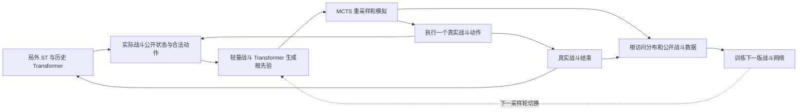

# SlayTheModel 训练缺口与基于实际数据的修复交接

更新：2026-11-10。

**用户最新要求：以 `runs/main-a0-s1/` 的实际训练结果为主要依据，独立分析模型学到了什么、哪些关键能力没有学到，以及原因更可能出在哪里，再提出新的修复方案。本文是 Codex 提供的分析与建议，可以参考、调整或否定；只有 G1、G2、G3 三项 P0 是必须处理的问题。** 不要把其余章节当成已经批准、必须逐条实现的功能清单。

用户倾向于 **Transformer 先验＋MCTS 模拟**，也希望评估更大的搜索预算；请优先评估这个方向，但具体网络结构、共享或独立骨干、规模、训练方法、预算和实施顺序由本轮证据与验证方案决定。当前这些升级尚未实施。

阅读优先级：用户最新要求 → 原始训练数据与可复现检查 → 本文的证据及候选建议 → [原训练方案](st-dt-training-handoff-20261110.md)与模块 README 的历史记录。旧文档中“只收到 val@0”已过期，“固定 MCTS、不训练战斗网络”不再限制新方案；从自身探索产生数据、真实游戏选择、信息隔离与数据保全等原有边界继续保留。

## 0. Claude 本轮应先交付的分析与新方案

**先诊断，再选结构。** 已有平均层数、跨幕率的提升说明模型并非完全没有学到有用信息；要区分已学到的能力、尚未形成的能力，以及可能被验证条件掩盖的能力。不能预设“Transformer 架构不行”“模型太大／太小”或“奖励一定错了”。

1. **先核对原始材料。** 读取 `runs/main-a0-s1/` 的 `config.json`、`summary.json`、`metrics.jsonl`、`eval.jsonl`、`eval/` 和 `archive/`；JSONL 与 CSV 是同一批日志的不同格式，不能重复算样本。结合采样、网络、PPO、奖励与搜索源码复核本文数字。本文统计和分析脚本用于定位问题，不代替原始证据。
2. **还原学习过程。** 按训练阶段、更新批次、幕数与场景统计表现，定位休息／跳牌／确认等行为何时变少，检查是否对应切档、KL 停止或超长循环批次。用有相关合法选择的机会数作分母；同时分析成功与失败轨迹，区分训练和固定种子验证。
3. **沿完整链路查原因。** 检查公开观察是否缺信息或编码错误，HP／牌组／候选是否实际进入模型，ST 与历史窗口、mask 和奖励历史是否正确，候选数量／动作表示是否造成偏置，采样与概率重算是否一致，以及奖励记账、GAE、辅助标签和优化步是否提供有效学习信号。再评估固定 MCTS 能力与搜索噪声对训练结果的影响，不能把整条链路的问题都归给网络结构。
4. **为原因安排可区分的验证。** 对重要现象提出竞争性解释，给出能够支持或否定它们的检查。优先使用现有轨迹、可用权重、同状态复现和小规模单变量对照；说明固定了什么、改变了什么、看哪个指标。P0 修复前后的结果分别记录，不混成同一实验。注意力图、相关性或一两个成功案例都不能单独证明原因。
5. **交付新的修复方案。** 每项写清“现象 → 文件／字段／样本证据 → 候选原因及可信度 → 验证方法 → 修复措施 → 验收指标与资源成本”。区分已确认、较强怀疑和证据不足；说明采纳、修改或放弃了本文哪些建议。P0 必做，其余按影响和证据排序，优先给最小可验证方案，不先承诺全部重构或跑满新一轮长训练。

**数据能力边界：** 当前本机 run 目录已有日志和局外 archive，没有收到 `best.pt`、逐步战斗轨迹或完整策略分布。仅有选中动作的 log probability，不能据此还原某状态所有动作的概率。若 Claude 所在机器有权重，先核对它属于哪个训练时点；预计 4,033 局的 best 不能代称 6,001 局最终网络。没有对应权重时，不能宣称完成了对最终网络激活、梯度或输入敏感性的检查；列出需要补充的最小材料，并继续可用数据能支持的分析。

## 1. 当前实际进展

| 项目 | 已核实的状态 |
| --- | --- |
| 局外网络 | `model/spire_rl/`，201,271,813 参数；ST 编码当前实体，因果历史 Transformer 处理最近 32 个局外决策，在线 PPO 学习 |
| 当前战斗器 | 固定 C++ MCTS，无神经网络先验、无神经网络叶子价值；UCB 树搜索＋随机 rollout＋手写战斗评分，每次执行一个动作再重新搜索 |
| 当前预算 | 普通与精英每个战斗决策 128 次模拟，Boss 512 次；不是每场战斗总预算。模拟内最多推进 500 个动作 |
| 首轮训练 | 6,001 局、137 次 PPO 更新、320,117 个局外决策；7 胜、5,991 死亡、3 次截断、0 工程失败 |
| 停止原因 | 进入 stage 3 前仅在 7 个不同训练种子上获胜，低于配置门槛 10；停在 stage 2，未训练 alpha=0 阶段 |
| 轨迹证据 | `runs/main-a0-s1/archive/` 共 137 个 NPZ，约 157 MB 压缩文件；完整展开约 9.6 GB，分析时逐文件读取 |
| 权重保存 | 当前只保存验证最优 `best.pt`，按日志与源码应对应 4,033 局；没有 6,001 局末尾权重保存路径。本地本轮未检查该权重文件 |
| 环境 | 远端 Windows＋WSL2，Conda `slay` / Python 3.12.0；用户报 RTX 5090、24GB，启动时读取实际型号与显存，不按型号猜容量 |

每次验证使用同一组 200 个种子，结果如下。现有验证输入存在第 4 节所述错位，影响幅度尚未测定。

| 训练局数 | 通关 | 平均层数 | 到第二幕 | 到第三幕 |
| ---: | ---: | ---: | ---: | ---: |
| 0 | 0/200 | 10.96 | 1% | 0% |
| 2,034 | 0/200 | 17.97 | 21.5% | 1% |
| 4,033 | 1/200 | 20.03 | 31.5% | 2.5% |
| 6,001 | 0/200 | 20.81 | 34% | 3% |

模型已能走得更远，但没有稳定通关证据；一次 1/200 变成 0/200 不足以证明退化。训练日志约为数小时量级，不能据此外推新战斗网络和更大搜索预算仍能一天完成 10,000 局。

## 2. 问题、候选改进与优先级

**仅 G1–G3 的 P0 必须处理，具体修复方式允许根据诊断调整；若当前源码已修复，应提供验证而不是重复改动。** P1 是参考优先级，表示值得分析的现象或能力缺口，不表示本轮必须全部实现，更不证明它们已经导致本次低胜率。后续项保留记录。

| 编号 | 优先级 | 问题或候选改进及证据 | P0 修复目标或非 P0 参考方向 |
| --- | --- | --- | --- |
| G1 | P0 | NoSL 审计 15 项中 7 项失败；隐藏牌序和遗漏 RNG 可影响搜索 | 修复信息隔离，新增回归并保留旧失败证据，见第 3.5 节 |
| G2 | P0 | 验证始终传 stage 3、alpha=0，但本轮只训练 stage 0–2；stage 和缩放奖励确实进入网络 | 训练、验证、部署输入条件明确且一致，禁止用未训练的阶段条件做唯一强度评估 |
| G3 | P0 | 3 次截断都在 Sea Glass 选牌界面反复勾选／取消，不选确认；循环分别占当批采样的 56.9%、58.4%、63.9% | 保留真实选择，解决循环与单菜单占满批次的问题；先查原因，不预先指定必须重构动作头 |
| G4 | P1 | 用户偏好战斗 Transformer 先验；当前未接入，现有 `mcts_priors` 等接口不等于已有先验模型或训练闭环 | 评估先验是否解决已识别的战斗瓶颈；若采用，再实现公开战斗编码、搜索与自生成训练闭环 |
| G5 | P1 | 最后 1,000 局的 3,304 次休息／升级选择全部升级，其中 229 次 HP<30%；2,027 次升级给 Strike | 检验动作类型偏置、HP 利用、信用分配与优化状态；依据证据修复，不以硬编码血量阈值代替学习 |
| G6 | P1 | 同期 9,412 次可选卡牌奖励只跳过 61 次；stage 2 有精英路线可选的 2,207 次决策仅选择 29 次 | 分场景、分机会统计策略；检查过度拿牌、回避精英和后期成长，不把固定跳牌率／精英率当最优目标 |
| G7 | P1 | 137/137 次 PPO 更新触发 KL 提前停止；113 次未遍历完一遍目标，平均有效遍历约 0.65 次 | 查清 KL、学习率和采样组成；记录实际更新覆盖，不能以配置 epochs=4 声称完成四遍训练 |
| G8 | P1 | 每约 2,000 局切一次奖励档位；当前默认 gate 失败就停止 | 按表现和门槛保留当前档位，在总预算内继续学习；已有 `--gate-policy hold`，不是从零实现该开关 |
| G9 | P1 | 没有 last、权重继续训练入口或完整恢复；best 不能代表最后状态 | 区分权重继续训练和精确续训，保存末尾状态，限制磁盘占用并保护旧实验 |
| G10 | P1 | 当前归档只含局外决策，没有逐步战斗、MCTS 根访问分布、完整策略分布或最终状态 | 补战斗训练数据、诊断数据、版本来源及分场景监控，见第 6 节 |
| G11 | 后续 | A10 CLI、自动进阶课程、完整原生整局差分仍未交付 | 单列任务和验收；不能把 A0 训练成功或 C++ 冒烟当作 A10／原生等价证明 |

**行为证据的边界：** 预先选取 10 个低血量幕末死亡案例，本地有 9 个在逐步公开观察、奖励和终局结果上与原轨迹完全匹配；只把最后升级换为休息，其中 2 个通过原本会死亡的 Boss。另 1 个本地复现不一致，已排除。这支持“部分局外选择存在可改善空间”，不能估算总体胜率提升，更不能推出低血一律休息。7 条通关轨迹也均没有记录到主动休息。

## 3. 战斗 Transformer 与自生成训练的候选方案

本节是 Codex 的原始技术建议，供诊断后取舍，不构成新增必做项。若采用其中某种实现，信息隔离、正确概率与版本对应等正确性条件仍需满足。

### 3.1 候选范围与模型规模

可先验证 **Transformer 根动作先验＋隐藏信息 MCTS 模拟**，保留 rollout 完成模拟。树内更深层先验、神经网络叶子价值也可以纳入比较；是否采用及顺序由数据与成本决定，不能把只接根先验描述成所有节点都用了网络。

一种待验证的实现是保留约 0.2B 局外网络，新增轻量战斗 Transformer，以宽度 256、4 层、8 头、FFN 4 倍、约 5–20M 或更小为探索起点；这些参数并非现有 run 证明的最佳配置。共享骨干、独立骨干或其他规模都可提出，但需解释它们针对哪项证据，并比较训练相互影响、显存与吞吐。

用户原有上限是总参数不超过 2B；当前执行预算仍以约 0.2B 主实验为先，后续大档约 1B、备用约 0.7B。新增战斗模块必须计入总参数和显存，不能在每个 MCTS 节点单独调用一个大历史网络而不测吞吐。无现成预训练数据，不假定旧 ArmG 权重可用。



### 3.2 输入、输出和搜索接口

- 输入包含玩家公开资源与能力、手牌实例、无序牌堆内容、敌人公开状态与意图、遗物／药水、当前选择上下文及合法动作。卡牌成长、费用修正、附魔、保留等属性不能丢失；牌区以类型区分。需要历史时只使用已经发生的公开事件。
- 禁止输入真实隐藏牌序、未来 RNG、种子、未公开敌人内部状态、内部 UID 数值或事后结果。UID 可作为执行绑定，不作为模型特征。合法已知置顶信息单独表示并验证来源。
- 输出与本次合法候选一一对应的 logits，mask 后得到先验 `P(a|o)`；含结束回合、药水、目标和战斗选牌。候选重排时，按动作语义映射后的概率应一致。
- 首版可复用 `mcts_priors` 的根 PUCT 接口，显式传 `resample_hidden=true`。先验严格校验候选顺序、长度、有限数值与归一化；不依赖接口默认值。根节点用先验引导，树内首版仍用现有搜索规则。
- 当前 `MctsResult` 不返回训练所需的根访问统计。扩展诊断接口返回逐候选 visits、均值／评分、原先验、执行动作、实际模拟次数和耗时，保留已有调用兼容性。最终动作从跨重采样结果聚合，不能挑最幸运的一条模拟并整段执行。
- 多环境战斗根状态批量送 GPU 推理，再交 C++ 搜索。每次真实动作后刷新观察、候选和先验。缓存按公开状态＋网络版本区分，不能跨隐藏假设误复用；测量 GPU 调用、CPU 等待和锁开销。

### 3.3 没有预训练数据时怎么启动

1. 修复 NoSL 后，用合法动作随机／近均匀局外策略及修复后的纯 MCTS 产生初始战斗数据；保留成功、失败和不同牌组／幕／敌人。可以复用已有可验证的重放作诊断，不能把当前仅含局外选择的 archive 宣称为现成战斗监督数据。
2. 每个真实战斗决策保存公开输入、合法候选、MCTS 根访问次数 `N(a)`，策略目标为归一化访问分布；温度变换及探索参数显式记录。用交叉熵训练战斗先验，不仅模仿最终选中的一个动作。
3. 随机初始化网络不直接替代一个已经较强的搜索器。先与纯搜索做对照，训练期可配置根探索或与均匀先验混合，防止初期过窄先验压制其他合法动作；验证时关闭训练专用噪声。
4. 达到首轮对照标准后，冻结该版战斗网络采集一个完整局外 rollout，再更新局外 PPO；战斗网络只在约定边界切换。每批数据绑定局外策略、战斗策略、搜索配置及规则版本。
5. 战斗监督训练可使用带版本的自生成 replay；局外 PPO 仍使用本轮行为轨迹。不能把 MCTS 执行的动作当成直接从网络先验采样，再用先验 log probability 套 PPO。旧局外 archive 不直接混入在线 PPO。

若以后接入叶子价值网络，应明确预测对象、标签与量纲。例如预测真实战斗胜负和战后 HP；死亡、可信截断及工程失败分别处理，未来结果只作标签。当前手写胜利评分约为 `100×(35+HP+4×剩余药水−0.01×回合)`，不能直接混入一个取值约 0–2 的价值预测。终局与叶子评分、归一化和药水权重必须一起定义并做对照。现有回调能读取整个 `BattleContext`，新增网络适配层必须仅导出公开数据。

### 3.4 搜索预算与强度验收

| 配置 | 普通／精英每决策 | Boss 每决策 | 用途 |
| --- | ---: | ---: | --- |
| 原预算 | 128 | 512 | 修复后的基线 |
| 新预算候选 | 512 | 2048 | 用户要求提高预算后的首个对照 |

将预算、先验模式、网络检查点、PUCT 系数、rollout 模式和探索设置接入配置与 CLI，写入运行记录。当前 CLI 没有普通／Boss 预算参数，不能只改一处默认值而漏掉训练／评估路径。后续可独立配置精英预算。

若同时试验预算与先验，可对照四组：纯搜索旧预算、纯搜索新预算、带先验旧预算、带先验新预算。使用同一批战斗起点和搜索种子集合，并包含普通、精英、Boss，各幕和多种 HP／牌组；原建议为 100 个分层战斗起点、每个 3 个搜索种子，另报固定整局验证。规模应根据实际成本调整，不是硬性数量或显著性保证。

报告战斗胜率、战损、药水消耗、动作数、模拟次数、单动作耗时及端到端每局时间；同时做固定预算和可比时间成本的比较。不能只报告“预算增加四倍”，也不能根据那 9 个预选失败案例判定总体增益。首版允许收益不足，但必须可复现地比较，结果不足时不宣称新战斗器更强。

### 3.5 NoSL 是接入先验之前的条件

完整证据见 [NoSL 审计](mcts-nosl-audit-20261110.md)。当前确认三类缺口：

1. `BattleContext::resample_hidden` 排序键遗漏同名牌的成长等实例属性，真实隐藏顺序可影响相同搜索种子的采样。
2. `visible_choice_key` 未覆盖已输出的 `bonusBlock`、`retainThisTurn`、`slyThisTurn`、`slyThisCombat`，公开编码可能保留隐藏次序。
3. 新增 `orbRng` 没有重采样，原生初始化／保存映射也需核验；不能只随意重置一个种子就称规则对齐。

修复必须覆盖完整可见实例属性、所有未来随机流、clone／snapshot／restore，以及合法已知置顶。模型、先验和叶子价值只能看当前模拟已揭示的信息；模拟未来抽牌本身允许，提前读取真实未来不允许。

验收：公开信息相同、仅真实隐藏牌序／隐藏 RNG 不同，固定搜索种子下，网络输入、语义对齐后的候选／先验、根访问统计及最终动作应一致。保留不同公开实例属性的区分。对纯搜索和带先验路径分别执行，新旧用例都要通过；同一平台要求确定性，跨平台差异另记录定位。测试通过不自动证明整局原生等价。

## 4. 局外训练待诊断问题与候选修复

本节只有 G2 评估错位、G3 菜单循环属于必做问题；其余方法和数值供新方案取舍。用户关心的“过渡能力与未来上限”是诊断目标，不预设唯一网络或奖励实现。

### 4.1 评估条件与 PPO 更新

`train.evaluate()` 固定使用最后一档 stage、alpha=0；`data.collate()` 将 stage 与历史 `r_train` 输入网络。因此早期模型接受了未训练的阶段嵌入和不同奖励历史。修复时分清“评测按真实胜负计分”和“网络输入条件”，两者无需强制相同。

最低要求：评估明确沿用 checkpoint 已训练的条件，另报部署条件测试；输出 policy stage、历史奖励编码、实际搜索配置。更长期可去掉 Actor 的离散训练阶段输入，将历史奖励改为固定编码的实际事件分项，价值头另接当前奖励条件；这种改动需要新模型版本或明确迁移，不能静默套旧权重。

对 PPO，补记每个 minibatch 的 KL、触发停止的 KL、学习率、处理目标数、重复遍历次数和梯度裁剪前范数。日志里的 `epochs` 当前是进入过的 epoch 数，不是完成次数。核对 KL 计算时点、统计聚合、优势尺度及循环样本影响；在配置中提供学习率覆盖，可先对照 `1e-4` 与 `3e-5`。保留 KL 保护，不以强行跑满四遍或直接放宽阈值作为修复。未更新参数时，采样和重算概率必须继续一致。

### 4.2 动作类型探索与菜单循环

火堆经常是 1 个休息候选和十几张具体升级候选。初始候选均匀不等于休息／升级两种行为均匀；这是结构性探索偏置，尚不能断言是行为单一化的唯一原因。

推荐在网络内部使用 `P(动作类型|状态) × P(目标|动作类型,状态)`，仍对外执行原来的一个合法动作，不新增虚假游戏步骤。类似地处理买牌／买遗物／删牌／离开、选牌／确认／取消等。也可提出等价方案，但需检查重复目标数量不会无意压低其他动作类型。

PPO 保存与重算实际联合 log probability；熵分为动作类型熵和条件目标熵，权重显式配置，不能让目标间随机性掩盖“不再休息／确认”。如用随机混合探索，行为概率必须包含混合后的真实分布。

Sea Glass 必须保留原生 0–15 张选择、反选与确认。增加同界面累计步数、相同公开状态循环和选择／取消／确认计数；对异常循环中止并单列 `menu_loop`，不得自动选牌、自动确认、伪装死亡或删除合法选项。可信截断保留末状态用于 bootstrap，缺失标签继续屏蔽。

采样器应避免为等待一个卡住的 episode 而让其贡献数千个目标；配置同菜单上限和超长轨迹处理，保证采样、截断、GAE、统计的语义一致。不要事后无记录地只删去循环步。验收包括三条已知 Sea Glass 失败种子与新增受控多选用例；技术上能截断还不够，策略也应能在合理步数完成选择并离开。

### 4.3 奖励与课程

继续保留目标：**在能活过当前压力的前提下发展后期上限，最终提高真实通关率。** 前期攻击牌的过渡价值、能力牌的启动条件、升级的长期收益、事件花血、商店资源和路线风险都应由后续结果学习。

```text
r_raw = 5 × 首次真实通关
      + alpha × (0.05 × 新完成楼层 + 0.5 × 新进入第二／第三幕)
r_train = r_raw / 5
gamma = 1
```

不直接奖励回血、休息、升级、抓能力、金币或大／小牌组；不按掉血固定处罚。正常死亡额外 0，工程失败和截断单独处理。楼层奖只在首次完成发放，菜单循环不能重复领取。下一战存活、战后 HP、本幕完成继续作为辅助预测，不直接改游戏奖励；HP 标签必须在奖励及过幕回血前取值。

现有 alpha 为 1→0.5→0.2→0，约每 2,000 局请求切档，门槛不足默认 stop；已有 hold 开关。参考方向是在总训练预算内 hold，并依据能力和最近验证决定降档。Claude 应先检验切档与学习变化的关系，再决定是否改调度；10 个获胜训练种子只是旧初值，不等于学会通关。记录切档、保持及停止原因；到总预算未达标就如实报告，不自动增加局数或改门槛。

“最终至少 2,000 个有效正常结束的 alpha=0 完整训练局”是原方案标准，由新方案说明是否继续采用，不作为本轮诊断与 P0 修复的必达条件。A0→A10 是另一条难度课程，不能与奖励 alpha 混为一谈；难度 CLI、升阶及回退可留待后续。

## 5. 保存、继续训练与兼容性

以下是可选的工程改进，不要求本轮全部交付。此前 best-only 是用户为节省空间作出的选择；是否补恢复能力及保留多少文件由新方案安排。若实施，权重继续训练与精确续训不能混称：

| 能力 | 最小实现与验收 |
| --- | --- |
| 权重继续训练 | 提供显式加载入口，在新 run 中加载兼容局外／战斗权重；优化器与采样状态重建。记录来源和新的训练条件，不能称为从 6,001 局精确恢复 |
| last 与 best | 在完整 rollout／更新边界及正常、gate 退出时保存 last；best 按明确且一致的验证规则选取，记录平局规则。原子写入、有限轮换，不每局复制权重 |
| 完整断点恢复 | 可选低频完整保存模型、优化器、调度器／适用的精度状态、RNG、下一局／更新编号、奖励档位与 gate、最佳评估、战斗网络版本及 replay 清单；优先只承诺已收完在途局的安全边界 |

完整恢复需验证中断前后无种子重复／漏采、无档位错误、日志不覆盖，以及下一轮采样与更新在支持的同平台确定性条件下可复现。跨平台仅保证经校验的兼容加载，不承诺逐位一致。

Checkpoint 和 archive 增补规则、观察、动作、搜索、奖励／历史编码、模型与优化器格式的版本和指纹；保留源码、二进制及设备来源。跨平台二进制哈希不同应能明确解释，不能只靠相同 ruleset 字符串放行，也不能改哈希强行加载。网络／信息边界变化后显式迁移或新实验；旧 best、原始权重与证据保留。

交付时报告 best、last、完整恢复文件及原子替换时的峰值磁盘预算，完整快照可选且限量。旧 archive 没有 optimizer／RNG 状态，不能凭它恢复已经丢失的最终模型。

## 6. 可选监控与数据补充

先使用已有数据回答第 0 节的问题；下表供选择必要的补充采集，不要求为出诊断报告先实现整套监控。

| 类别 | 最低指标或字段 |
| --- | --- |
| 独立强度 | 固定种子通关率及区间、跨幕率、死亡位置、工程失败／截断率；训练与验证分开，固定测试集留作最终报告 |
| 局外行为 | 各 HP 档休息率、幕末休息／升级、跳牌率、升级／删牌目标、按“有该路线可选”统计精英率、遗失奖励、商店消费与余钱；注明分母和样本数 |
| 探索与更新 | 分场景动作类型／目标熵、选中概率、KL 停止位置、有效目标遍历次数、各损失／梯度及当前 alpha；value loss 下降不作为实力结论 |
| 战斗搜索 | 先验与搜索后分布、根 visits、实际预算、战斗胜率／战损／药水、纯搜索与带先验的对应网络版本；先验关闭也能运行 |
| 循环与资源 | 同菜单步数、循环截断原因及批次占比；CPU／GPU 分段时间、推理批量、内存／显存与磁盘量。并行 worker 秒数不能直接相加当墙钟时间 |
| 可复盘数据 | 真实公开战斗状态、合法动作及执行绑定、根搜索统计、实际动作／战斗结果、最后公开状态、搜索种子和全部版本；种子等复现元数据与模型输入严格分离 |

默认保存压缩的真实决策级战斗数据，不保存每一条 MCTS 内部分支和大对象快照。详细搜索树／引擎快照只对可配置诊断样本保存。为 replay、日志及检查点设容量和保留策略，列清可再生数据；不清理用户原始权重、不可变参考和固定原生安装。

## 7. 工作顺序改为先诊断再决定实现

以下取代此前先定网络、再按五批补齐全部功能的安排。只有 P0 问题修复是固定开发范围；其他改动由诊断后的新方案决定。

| 阶段 | 交付范围 | 完成依据 |
| --- | --- | --- |
| 1 | 复核 run 数据、当前源码和已有分析 | 给出学习过程、行为变化、已学到／未学到的能力及证据缺口，不直接归因于网络架构 |
| 2 | 处理 G1 NoSL、G2 评估错位、G3 菜单循环；可与诊断交错进行 | 三项都有明确验证，保留修复前后证据；保留真实选择，不用自动代选掩盖循环 |
| 3 | 小规模检查或单变量对照，区分剩余原因 | 每个重点结论有可追溯证据或明确的不确定性；需要权重／新数据时列出最小补充清单 |
| 4 | 提交基于这次训练的新修复方案 | 解释改哪里、为何这样改、怎样验证、预期成本；明确采纳和放弃了哪些 Codex 建议 |
| 5 | 按最终选定方案再安排实现与训练 | 不默认全部 P1、固定网络尺寸、四倍预算或长训练均已获批准；交接实际可运行命令与未完成项 |

每批给出：改动文件、已完成／未完成项、测试与失败原因、资源成本，以及可复制的启动／评估／监控命令。CLI 名称以实际实现为准，本文不把计划中的参数冒充现有命令。源码改动先做针对性回归；涉及 C++ 规则与接口时还需遵守根 AGENTS 的回归要求。文档更新不要求重复整套长训练。

## 8. 其他需要保留的模拟器与实机事项

这些事项不能随训练框架改造而被标为完成，也不应混入“提高 MCTS 预算”的补丁。

| 事项 | 状态与后续要求 |
| --- | --- |
| 原生执行证据 | 第三步起的新增规则大量按源码移植，仍缺对应目标 DLL 受控执行和完整同种子、同账号进度、同决策整局差分；固定原生安装已保全，恢复 fixture 宿主后另开验证目录 |
| 回合开始钩子 | 现有交接记录指出 `after_hand_drawn` 中 Mayhem 与遗物执行先后和原生不同；Claude 先复核当前源码，再做受控对照，跨角色组合不能仅因主角色是铁甲而忽略 |
| 观察占位字段 | `nextTurnEnergy`／`nextTurnDraw` 目前有读取、输出与清零，没有设置非零值的写入方；接战斗网络前核验真实效果是否另存能力状态，不能当成完整可信的汇总特征 |
| 数值与容量边界 | C++ double／原生 decimal 的取整，以及牌堆／遗物固定容量仍待边界验证；这属于待核验范围，不是每项都已证明有错 |
| 实机接入 | 新 `spire_rl` 只接 C++ 模拟器；旧 `armg_live_worker.py` 手工观察仍是旧布局，实际游戏选牌网格和 UI 执行未验证。新模型实机桥接应独立设计验收，不借本轮恢复旧训练路线 |
| 多人范围 | 当前目标是铁甲单人；多人专用内容仅按单人过滤，不承诺多人规则完整 |

## 9. Claude 的代码与证据入口

以下路径相对仓库根；两条路线继续隔离。训练开发在 `v111_SF1`；`v111_simulator_test` 用于模拟器独立交付，不能把新网络和训练产物混进去。`workspace_YE` 不属于本轮整合目标。

| 内容 | 位置 |
| --- | --- |
| 当前总交接与原设计 | `AGENTS.md`、`docs/st-dt-training-handoff-20261110.md`、`model/spire_rl/README.md` |
| 训练、验证、保存 | `model/spire_rl/spire_rl/{train,ppo,checkpoint,config,__main__}.py` |
| 实体／历史／采样／归档 | 同目录 `{model,data,env,rollout,archive,metrics}.py` |
| C++ 工作副本 | `artifacts/dev/cpp-native-aligned-20261031/`，下文 C++ 文件均相对此目录 |
| 宏观战斗入口与观察 | `simulator/src/macro_obs.cpp`；当前 `play_combat_mcts` 调普通 `mcts`，不是先验接口 |
| 真正树搜索与评分 | `simulator/src/mcts.cpp`、`mcts_internal.h`、`include/sts2/search.h`；不要误将 `src/search.cpp` 的另一套 rollout 当成当前训练树搜索 |
| 先验与价值绑定 | `simulator/bindings/bindings.cpp` 的 `mcts_priors`、`mcts_depth_priors`；适配层需要阻断完整隐藏状态传入网络 |
| 信息隔离修复 | `simulator/src/battle.cpp`、`observe.cpp`、`defect.cpp`；旧证据在 `validation/nosl-audit-20261110/` |
| 选牌循环 | `simulator/src/card_candidates.cpp` 与 `run.cpp`；Sea Glass 网格 kind=14，合法确认存在，不能靠删除原生选择解决 |
| 小日志包与完整轨迹 | 根 `main-a0-s1-review.tar.gz`；`runs/main-a0-s1/archive/rollout_00001.npz` 至 `rollout_00137.npz` |
| 统计与复现 | `artifacts/analysis/main-a0-s1-20261110/` 的 `analysis.json`、`trajectory_summary.json`、`trajectory_manifest.json`、`rest_counterfactuals.json`、两张 review 图及分析脚本 |

`analysis.json` 是先收到小日志包时的检查，里面“未收到 archive”仅描述当时输入；完整轨迹的新证据以 `trajectory_summary.json` 为准。复现差异案例 seed=1005081 尚未定位，不能假定跨平台全部等价；救回即时 Boss 的两个受控案例为 1005032、1005037。

证据目录和部分新文件受 Git 忽略；只发本文时，核心数字已在文内，不能假定 Claude 机器自动有 NPZ、权重和原生 DLL。需要复现时再按清单提供，不把全部 artifacts 加入 Git。

原生目标仍为 v0.111.0 / 41cef1ea。后续事件／角色／Boss 移植已有实现，不重抄旧 10 月“全部未实现”清单；尚未完成完整同种子、同进度、同决策的原生整局差分。NoSL 修复与规则等价是不同验收任务。新工作沿用当前 C++ 副本，不重写引擎，不改旧 ArmG、`model/spireformer/` 或旧 `combat/` 路线；重要新证据放新目录。提交、推送和长训练按用户后续指令执行。
