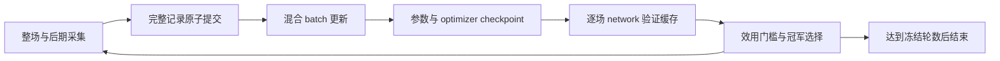

# T4 新运行编排与预算冻结

日期：2026-10-17。**实现、冻结与必要测试交付；未启动 S smoke 或正式训练。**

入口：`scripts/run_az_transformer_t4.py`。运行协议 `transformer-t4-run-v1`，Replay `t4-mixed-replay-v1`；配置在 `configs/az_transformer_t4_v1/execution.json`，绑定既有课程/留出协议、当前源码、入口脚本及 Python/Torch/NumPy 版本。旧 T3 权重、Replay 和运行目录不能作为新初始化或兼容恢复入口。

## 1. 冻结的运行预算

| 项目 | S smoke | S 正式 |
|---|---:|---:|
| 新模型初始化 seed | 41 | 42、43，分别从头初始化 |
| 轮数 | 2 | 每 seed 3 |
| 每轮整场 / 后期轨迹 | 135 / 45 | 135 / 45 |
| 每轮优化器更新 | 4 | 16 |
| 有效 batch / microbatch | 64 / 8 | 64 / 8 |
| 每 batch 整场 / 后期样本 | 48 / 16 | 48 / 16 |
| 两类 Replay 活跃行上限 | 150,000 / 50,000 | 150,000 / 50,000，独立于其他 seed |
| 采集 search simulations / 最大深度 | 8 / 128 | 8 / 128 |
| 每轮配对验证 | 256 场 × 初始冠军/候选 | 256 场 × 当前冠军/候选 |
| 验证模式 | network，0 search simulations | network，0 search simulations |

采集按 `整场、整场、整场、后期` 循环，135:45 与 batch 的 48:16 都是 **3:1**。整场配方循环使用冻结的 48 个 train 模板，保持组合签名，使用独立的新 train ID/环境 seed；不会取用 validation 或两个留出集。后期起点沿用已冻结的自然来源，按先均匀选来源、再均匀选唯一前缀采样，重复来源不视为独立构筑。

smoke 总计 360 条完整记录、8 次更新；正式双 seed 总计 1,080 条、96 次更新。按完整预算执行时，总采集 1,440 条，其中整场 1,080、后期 360；优化器更新 104 次。到达轮数即结束，不因效果不佳加轮。

每场上限为整场累计 **400 决策 / 100 回合**；后期恢复保留原前缀已用预算和原始 H0。PUCT 1.5，训练 Dirichlet epsilon 0.25 / alpha 0.3，采集前 10 个本次决策采用温度 1，之后为 0；验证不使用探索。

模型 S、CPU、单线程、FP32、确定性算法；AdamW 学习率 0.0003、weight decay 0.0001、梯度裁剪 1.0。每轮从当前冠军复制候选并新建 optimizer；同轮恢复必须还原 optimizer，不能只加载权重。

## 2. Replay 与落盘

- 两类记录共用一个原子 manifest，但活跃队列、FIFO 行容量和采样配额分开。整场继续使用严格实体 Replay 契约，后期使用 `natural-late-suffix-v1`；后期记录不伪装成从 step 0 开始的整场。
- 每条完整记录以 gzip JSON 保存，manifest 是唯一提交点。轨迹、标签与版本校验通过后才能提交；同一 job 重试去除计时差异后必须语义一致，否则拒绝。
- 超容量时按池淘汰最旧的**完整记录**，不截断轨迹。被淘汰文件保留用于审计；因运行轮数固定，归档数量有明确上限。旧孤立临时文件不会被当作已提交数据。
- 采样先按固定 48/16 配额选池，再均匀选完整记录、均匀选其行，允许有放回采样。任一池为空则停止，绝不自动补成另一类或改变混合比例。
- 内存最多缓存 16 条 Replay 记录，行数从已校验 manifest 元数据计算，不把所有归档常驻内存。容量是行数约束，不承诺固定字节占用。
- 每次完成的 optimizer 更新保留独立 checkpoint，包含参数、AdamW 状态、更新计数、配置、源码摘要和指标；不覆盖此前已提交恢复点。
- 启动前要求剩余磁盘至少 10 GiB，每个运行边界检查至少 2 GiB 剩余；不足即停止。OOM 同样停止，不自动改模型、batch、microbatch 或 search 预算。S 的参数加 optimizer checkpoint 约为数十 MiB，全部 104 更新加初始权重可能占数 GiB；Replay/缓存另计，未宣称实测占用或吞吐。

## 3. 状态机与恢复



`state.json` 在每条轨迹、每次更新、每轮评估完成后原子更新，提供 phase、iteration、next_job、updates_done、冠军和工件摘要。进程中断后重新用相同命令恢复：

- Replay 已提交但状态未前进：校验并复用该 job，不重复插入。
- checkpoint 已落盘但状态未前进：从上一个已提交边界重新执行该次更新；batch RNG 和 Torch RNG 按 seed/轮次/更新号派生，结果可复现。
- 更新边界已提交：恢复参数及 AdamW 状态，下一次更新继续；同轮不会悄悄重置 optimizer。
- 验证被中断：按源码/计划、模型摘要、配方与索引命中的单场缓存继续；缓存键与行摘要都校验。
- 代码、配置、runtime、已提交 checkpoint 或 Replay 被改变时拒绝继续。运行锁阻止同一目录多个编排器并发写入。

不保存半条轨迹或半个 optimizer 更新；重跑最近未提交工作是明确的恢复边界。异常向上抛出，不当作死亡结果；回合/决策耗尽属于合法 timeout，保留在数据和报告中。

## 4. network 效用与最终留出

每轮仅调用冻结的 `network_gate`：256 场从原始战斗起点开始的 network V7 终局效用配对比较，95% bootstrap 下界大于 0 且完整性/合法性检查通过才晋级。search、价值头预测、后期快照分数和胜率均不决定晋级。

完成后另行复算 **最终冠军相对初始网络** 的效用门槛，正式运行不要求每一轮都晋级。工程通过与 `network_utility_accepted` 分开报告。

正式入口必须重新审计同一源码/协议的两轮 smoke，要求两个逐轮 network 门槛和最终累计门槛均通过。不会仅信任一个 `passed` 文件，也不会使用 smoke 权重初始化正式模型。

双 seed 正式三轮全部完成后，共同保存 `frozen_champions.json`，绑定两个冠军和两个初始 checkpoint 的 SHA-256，**再**执行最终留出：每 seed 的 24 未见组合、24 完整 ID，各评估初始/最终 network，共 192 场。读到这些结果之后不再训练、换冠军或改门槛。

这 24+24 的小规模分组是先导诊断，报告效用、进度所需终局事实、超时及错误；不参与晋级，也不宣称独立通用质量。按角色逐轮计算，smoke 最多请求 1,024 个验证结果，正式最多请求 3,072 个，最终留出 192 个；相同 checkpoint 的结果由缓存复用，实际新执行战斗通常少于请求数。

## 5. 证据校验与测试

`audit` 核对冻结 job 总体、Replay 摘要/内容/配方、所有更新 checkpoint、optimizer 更新计数、冠军链、终局事实和逐轮/最终 network 门槛。`audit-formal` 进一步核对共同冻结点、两类留出总体、文件摘要、V7 奖励及分组摘要。产生 `evidence.json`、`heldout_evidence.json` 和 `formal_evidence.json`；没有运行工件时不会伪造完成结果。

本轮运行的是临时测试：真实小型 XS 的两步更新与 checkpoint 恢复参数逐项相等；采集/更新/评估三个边界故障注入；真实合法整场及后缀的存储、FIFO、原子提交、损坏拒绝、采样比例和常驻缓存限制；验证缓存、联合冠军冻结、正式入口 smoke 门槛与未授权 CLI 拒绝。模拟编排测试不作为策略效用证据。

必要回归 **308 passed，48.87 秒**，见 `docs/transformer_t4_runner_tests.txt`；冻结及只读验证结果见 `transformer_t4_execution_freeze.txt`、`transformer_t4_execution_verification.txt`。冻结内容摘要为 `64b13f1d7d65920474d476dca7bc58dc1f06a0ba9646dfb31c44c39b5daeb4af`。**没有启动 S 实验，新 network 效用增益仍为未评估。**

## 6. 使用边界

只读检查：

```powershell
.\.venv-az\Scripts\python.exe scripts/run_az_transformer_t4.py verify-plan
```

未来经用户授权后使用 `smoke` 或 `formal` 模式，必须显式传 `--allow-experiment` 和新运行 `--root`；formal 还必须传 `--smoke-root`。本轮没有执行这些启动命令。`audit --seed 41/42/43 --root ...` 校验单 seed，`audit-formal --root ...` 校验正式父目录。

后续步骤是在用户授权下执行冻结的 S 两轮 smoke，先汇报/校验证据，满足门槛后再决定是否执行正式双 seed 三轮。已知 Boss 失败、少量自然来源和小规模组合覆盖的局限继续有效；不自动扩大模型或追加轮次。
